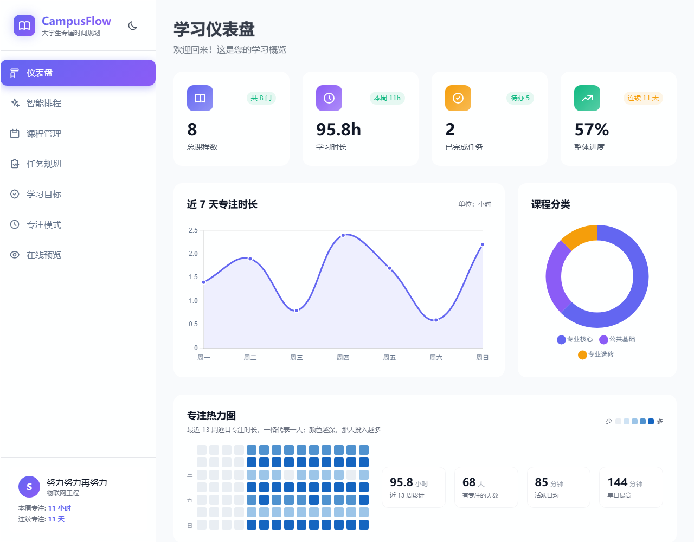
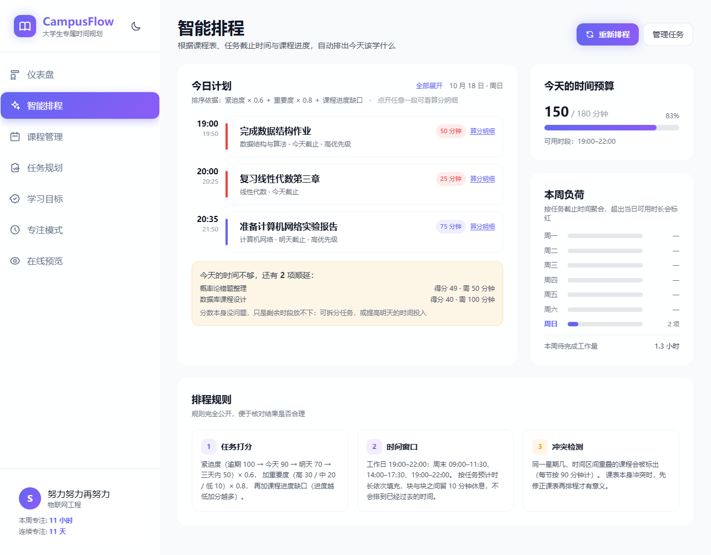
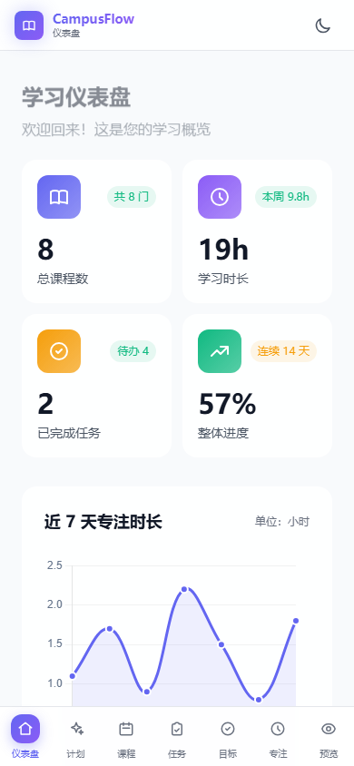
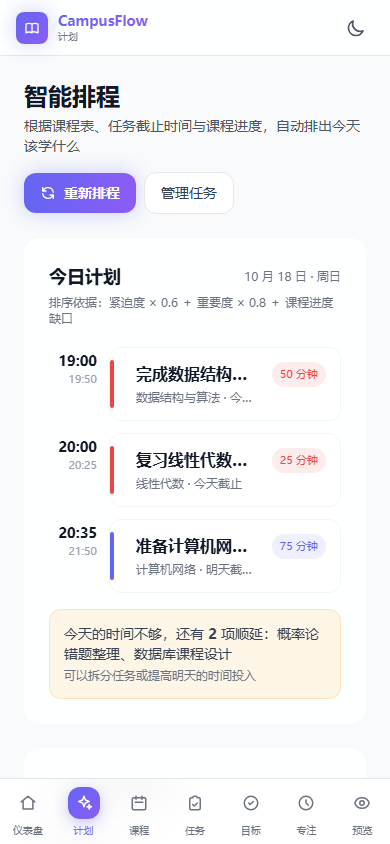
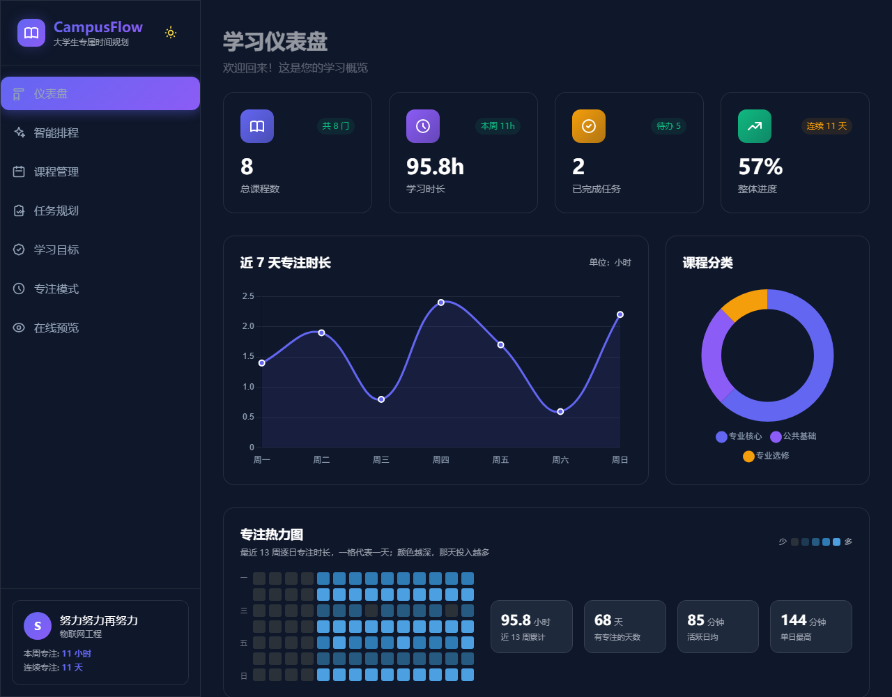

# CampusFlow - 大学生专属时间规划

[](https://github.com/648846/campusflow/actions/workflows/ci.yml)


## 项目概述

CampusFlow 是一个专为大学生设计的现代化时间规划和学习管理Web应用。它提供了课程管理、任务规划、学习目标追踪、专注模式以及在线预览等功能，帮助学生更高效地组织学习生活。

## 界面预览

桌面端（1280 px）：





移动端（390 px，顶部栏 + 底部标签栏）：

 

深色模式：



## 参赛材料

本项目参加**第十四届全国大学生数字媒体科技作品及创意竞赛**，赛道为「移动与网络应用开发」。配套材料在 `参赛材料/` 目录：

| 文件 | 内容 |
| --- | --- |
| `CampusFlow作品说明文档.docx` | 选题价值、功能与业务闭环、五层技术架构、智能排程算法（含完整算例）、测试与验证、数据隐私、局限与迭代计划 |
| `CampusFlow演示视频脚本.docx` | 5 分钟演示片的分镜脚本：11 个镜头、29 条带时间码的中文字幕、录制与剪辑规范 |
| `CampusFlow用户调研问卷.docx` | 12 题需求调研问卷、投放建议、三个统计口径、结果回填模板与访谈提纲 |

## 技术栈

- **前端框架**: 纯 HTML5 + CSS3 + JavaScript（无框架依赖，零运行时开销）
- **样式框架**: Tailwind CSS 3.4（构建期编译，产物已随仓库提供）
- **图表库**: Chart.js 4.4（本地引入）
- **文档预览**: PDF.js 3.11（本地引入）
- **数据存储**: LocalStorage（浏览器本地存储，无需服务端）
- **音频处理**: Web Audio API

> **离线可用**：项目不再依赖任何 CDN。`assets/vendor/` 与 `assets/css/tailwind.css`
> 均已本地化，断网、校园网、评委离线评审环境下表现完全一致。

## 功能特性

### 1. 仪表盘 (index.html)
- 四项核心指标：课程数、累计专注、已完成任务、平均课程进度（全部实时计算）
- 近 7 天专注时长趋势（数据来自专注模式真实记录）
- 专注热力图：最近 13 周逐日专注强度，深浅色块一眼看出坚持的起伏；并给出累计时长、活跃天数、活跃日均、单日最高
- 课程分类分布
- 今日安排：自动聚合当天课程与今日到期任务
- 待办提醒：按优先级排列的后续待办
- 需要重点关注的课程：按进度自动排序并给出建议
- 数据与隐私：一键导出 / 导入备份、清空数据

### 2. 智能排程 (plan.html) ★ 核心能力
- 把「课程表 + 任务截止时间 + 课程进度」合成一份可执行的每日学习计划
- 任务按加权分数排序后依次填入可用时间窗口，块与块之间自动留 10 分钟休息
- 排不下的任务明确标为顺延，不假装能完成
- 课程时间冲突自动检出并提示（同一星期几、90 分钟区间重叠）
- 本周负荷概览：逐天显示待完成工作量，超出当日可用时长标红
- 排程规则在页面上完整公开，结果可核对
- **算分明细**：点开任意一段安排，逐行看到紧迫度、重要度、课程缺口各自的取值、权重、得分与依据，以及它在本批候选中的排名；也支持一键全部展开

### 3. 课程管理 (schedule.html)
- 课程列表展示
- 添加/编辑/删除课程
- 课程进度追踪
- 课程分类管理

### 4. 任务规划 (tasks.html)
- 任务列表管理
- 任务优先级设置
- 预计时长设置（按番茄钟计），供智能排程使用
- 完成状态标记、筛选与搜索

### 5. 学习目标 (goals.html)
- 学习目标创建
- 目标进度追踪
- 目标统计分析
- 进度可视化展示

### 6. 专注模式 (focus.html)
- Pomodoro番茄钟技术
- 多种背景音效
- 音量控制
- 专注时间统计（记录会汇入仪表盘趋势与智能排程的课程缺口计算）

### 7. 在线预览 (preview.html)
- 文件上传功能
- 多种格式支持
- 实时预览显示
- 拖拽上传支持

### 8. 文件下载 (download.html)
- 所有HTML文件下载
- 直观的下载界面
- 文件预览图标

## 智能排程算法

排程逻辑集中在 `assets/js/scheduler.js`，全部为纯函数，不依赖 DOM，可单独测试
（`tests/scheduler.test.js` 覆盖 19 项断言，执行 `npm test`）。

**1）任务打分**

```
分数 = 紧迫度 × 0.6 + 重要度 × 0.8 + 课程进度缺口
```

| 因子 | 取值 |
|---|---|
| 紧迫度 | 逾期 100 / 今天 90 / 明天 70 / 三天内 50 / 一周内 30 / 更远 15 |
| 重要度 | 高 30 / 中 20 / 低 10 |
| 课程缺口 | (100 − 课程进度) / 10，即 0–10 |

**2）时间窗口**

- 工作日：19:00–22:00
- 周末：09:00–11:30、14:00–17:30、19:00–22:00
- 排当天计划时会剔除已经过去的时段，不会把任务排到过去

**3）冲突检测**

同一星期几、按 90 分钟一节课计算存在区间重叠的课程会被列出，提示先修课表。

**4）顺延规则**

当天窗口放不下的任务进入「顺延」列表并在页面明示，不会静默丢弃。

## 系统架构

### 目录结构
```
CampusFlow/
├── index.html          # 仪表盘（应用入口）
├── plan.html           # 智能排程（核心能力）
├── schedule.html       # 课程管理
├── tasks.html          # 任务规划
├── goals.html          # 学习目标
├── focus.html          # 专注模式
├── preview.html        # 在线预览（PDF / 图片 / 音视频 / 文本）
├── download.html       # 文件下载
├── assets/
│   ├── css/
│   │   ├── tailwind.css    # Tailwind 编译产物（勿手改）
│   │   └── app.css         # 布局与响应式样式
│   ├── js/
│   │   ├── store.js        # 数据层：读写 / 统计 / 播种 / 备份
│   │   ├── scheduler.js    # 智能排程引擎（纯函数，可单测）
│   │   └── nav.js          # 移动端顶部栏 + 底部标签栏（含 SW 注册）
│   ├── icons/              # PWA 图标 192 / 512 / maskable / apple-touch
│   └── vendor/             # Chart.js / PDF.js 本地副本
├── manifest.webmanifest    # PWA 清单（名称、图标、快捷入口）
├── service-worker.js       # 离线缓存：外壳预缓存 + 运行时缓存
├── scripts/
│   └── check-assets.js     # 站内引用 / 外链 / 清单完整性检查
├── tests/
│   └── scheduler.test.js   # 排程引擎 19 项单元测试
├── docs/screenshots/       # README 用界面截图
├── src/
│   └── input.css           # Tailwind 源样式（自定义工具类在此定义）
├── tailwind.config.js      # Tailwind 配置
├── main.js                 # Electron 主进程入口
└── package.json
```

### 测试与持续集成

```bash
npm test          # 排程引擎 19 项单元测试
npm run check     # 8 个页面的本地引用、外链残留、manifest 与 SW 清单完整性
npm run verify    # 以上两项一起跑（CI 用的也是这一条链路）
```

`.github/workflows/ci.yml` 在每次 push 与 PR 时自动执行上述两项检查，无需安装依赖（测试与检查脚本均为零依赖纯 Node）。

### 响应式设计
- **桌面端（≥1024px）**：左侧固定导航栏 + 内容区
- **移动端（<1024px）**：顶部状态栏 + 底部七宫格标签栏，内容单列自适应
- 已针对手机触控做优化：取消 hover 位移、加大点按区域、适配安全区

### 数据存储架构
```javascript
// LocalStorage 键名
- campusflow_courses    # 课程数据
- campusflow_tasks      # 任务数据
- campusflow_goals      # 学习目标数据（兼容旧键 learningGoals，首次读取时自动迁移）
- focusHistory          # 专注记录（写入后仪表盘统计即时生效）
- campusflow_settings   # 应用设置
- campusflow_seeded     # 是否已初始化示例数据
- theme                 # 主题设置
```

### 数据层设计（assets/js/store.js）
所有页面共用同一套读写与统计口径，避免"各页各算一套"：

| 能力 | 说明 |
|---|---|
| 容错读取 | 数据损坏时降级为空列表，页面不会白屏 |
| 写入反馈 | 浏览器配额满时抛出可见提示，不静默丢数据 |
| 统计口径 | 学习时长 = 专注记录累计；本周 = 含今天的最近 7 天 |
| 示例数据 | 首次访问自动播种一套贴近真实的课程 / 任务 / 目标 / 专注记录 |
| 备份恢复 | 导出 JSON、导入前校验格式，校验失败不覆盖现有数据 |

### 数据安全与隐私
- 所有数据仅保存在**本机浏览器**（localStorage），不上传任何服务器，无账号体系、无埋点
- 用户可随时导出完整备份（JSON）或一键清空
- 清空后不会被示例数据重新填充（通过 `campusflow_seeded` 标记）

## 安装和部署

### 本地部署

#### 方法一：直接打开HTML文件
1. 下载或克隆项目到本地
2. 直接双击任意HTML文件在浏览器中打开
3. 应用即可使用

#### 方法二：使用Python HTTP服务器
```bash
# 进入项目目录
cd CampusFlow

# 启动Python HTTP服务器
python -m http.server 8000

# 在浏览器中访问
http://localhost:8000
```

#### 方法三：使用Node.js HTTP服务器
```bash
# 安装http-server
npm install -g http-server

# 启动服务器
http-server -p 8000

# 在浏览器中访问
http://localhost:8000
```

### 安装为应用（PWA）

CampusFlow 是一个可安装的 Web 应用（PWA）。通过 http(s) 访问后，浏览器地址栏会出现安装图标，装完即是独立窗口的应用，**断网也能打开**（Service Worker 已缓存应用外壳）。

| 平台 | 操作 |
| --- | --- |
| 桌面 Chrome / Edge | 点击地址栏右侧的安装图标，或菜单 →「安装 CampusFlow」 |
| Android Chrome | 右上角菜单 →「添加到主屏幕 / 安装应用」 |
| iOS Safari | 分享 →「添加到主屏幕」 |
| 微信 / 内置浏览器 | 通常不支持安装，请用系统浏览器打开链接 |

安装后长按应用图标可出现「智能排程 / 任务 / 专注」三个快捷入口。

> 说明：Service Worker 只在 `http(s)` 下生效。直接双击 `index.html`（`file://` 协议）时功能完整可用，但无法安装、也不会写入离线缓存——这是浏览器的安全限制，不是应用缺陷。

### 部署到静态托管（Cloudflare Pages / Vercel / Netlify）

本项目是**纯静态多页站点**，没有服务端、没有打包产物目录——所有页面就在仓库根目录。托管平台需要这样配置：

| 配置项 | 填什么 | 说明 |
| --- | --- | --- |
| 构建命令 | `npm run build` | 只编译 Tailwind 样式，约 2 秒；也可留空或填 `exit 0`，因为仓库里已带编译好的 CSS |
| 输出目录 | `/`（即 `.` ，仓库根目录） | **不是** `dist`。填错会报"输出目录为空" |
| Node 版本 | 18 或 20 | 本项目的构建脚本零依赖，版本不敏感 |
| 环境变量（可选） | `ELECTRON_SKIP_BINARY_DOWNLOAD=1` | 避免安装约 200 MB 的 Electron 二进制，静态部署用不到 |

> 常见报错对照：
> - `命令 "npm run build" 以 127 退出` → 依赖没装或脚本缺失。本项目曾因 `tailwindcss` 未写入 `devDependencies` 触发此错，已在 v1.1.1 修复。
> - `No output directory named "dist" found` → 输出目录应填 `/`。
> - 页面打开 404 → 确认根目录存在 `index.html`（本项目入口是 `index.html`，不是 `dashboard.html`）。

GitHub Pages 也可以直接用（仓库已带 `.nojekyll`，无需任何构建步骤）。

### 演示数据（录屏 / 答辩前）

每次演示前把数据拉回同一个初始点，避免"上一次演示中途改过的东西"留在页面里。两种方式等价：

| 方式 | 操作 |
| --- | --- |
| 界面上点 | 仪表盘底部「数据与隐私」→「载入演示数据」 |
| 换链接打开 | 任意页面地址后加 `?demo=1`（如 `plan.html?demo=1`），加载时自动重置 |

重置后是一份刻意配好的数据：8 门课、7 项任务（含**今天 / 明天 / 本周 / 下周三**四档截止，覆盖排程的三个紧迫度档位）、3 个学习目标、70 天专注记录（带作息起伏，热力图不会是一条平线）。打开智能排程页会看到 3 段安排 + 2 项顺延，正好用来讲"时间不够时先排谁"。

### 样式开发（仅修改样式时需要）

仓库内已包含编译好的 `assets/css/tailwind.css`，直接双击 HTML 即可运行，
无需安装任何环境。仅当你**修改样式或新增 Tailwind 类名**时才需要重新编译：

```bash
npm install           # 首次执行，安装 Tailwind CLI
npm run css           # 编译一次
npm run css:watch     # 开发时监听文件变化
```

`src/input.css` 集中存放项目自定义工具类（玻璃拟态、动效、卡片等），
新增类名后必须重新编译，否则不会生效。

### 打包成App

#### 方法一：使用Electron打包

1. 安装Node.js和npm
2. 创建package.json文件：
```json
{
  "name": "campusflow",
  "version": "1.0.0",
  "description": "CampusFlow - 大学生专属时间规划",
  "main": "main.js",
  "scripts": {
    "start": "electron .",
    "package": "electron-builder"
  },
  "build": {
    "appId": "com.campusflow.app",
    "productName": "CampusFlow",
    "directories": {
      "output": "dist"
    },
    "files": [
      "*.html",
      "main.js"
    ],
    "win": {
      "target": "nsis"
    },
    "mac": {
      "target": "dmg"
    },
    "linux": {
      "target": "AppImage"
    }
  },
  "devDependencies": {
    "electron": "^28.0.0",
    "electron-builder": "^24.9.1"
  }
}
```

3. 创建main.js文件：
```javascript
const { app, BrowserWindow } = require('electron');
const path = require('path');

function createWindow() {
  const win = new BrowserWindow({
    width: 1200,
    height: 800,
    webPreferences: {
      nodeIntegration: true,
      contextIsolation: false
    }
  });

  win.loadFile('index.html');
}

app.whenReady().then(createWindow);

app.on('window-all-closed', () => {
  if (process.platform !== 'darwin') {
    app.quit();
  }
});

app.on('activate', () => {
  if (BrowserWindow.getAllWindows().length === 0) {
    createWindow();
  }
});
```

4. 安装依赖并打包：
```bash
# 安装依赖
npm install

# 启动开发版本
npm start

# 打包应用
npm run package
```

#### 方法二：使用PWA (Progressive Web App)

1. 创建manifest.json文件：
```json
{
  "name": "CampusFlow",
  "short_name": "CampusFlow",
  "description": "大学生专属时间规划",
  "start_url": "./index.html",
  "display": "standalone",
  "background_color": "#ffffff",
  "theme_color": "#6366f1",
  "icons": [
    {
      "src": "icon-192.png",
      "sizes": "192x192",
      "type": "image/png"
    },
    {
      "src": "icon-512.png",
      "sizes": "512x512",
      "type": "image/png"
    }
  ]
}
```

2. 在HTML文件中添加manifest链接：
```html
<link rel="manifest" href="manifest.json">
```

3. 部署到HTTPS服务器后，用户可以"安装"应用到主屏幕

#### 方法三：使用NW.js打包

1. 创建package.json：
```json
{
  "name": "campusflow",
  "version": "1.0.0",
  "main": "index.html",
  "window": {
    "title": "CampusFlow",
    "width": 1200,
    "height": 800
  }
}
```

2. 下载NW.js SDK
3. 将项目文件和package.json放入NW.js目录
4. 运行nw.exe启动应用

## 使用指南

### 基本使用流程

1. **启动应用**：打开index.html或通过导航访问首页
2. **添加课程**：进入课程管理页面，点击"添加课程"
3. **创建任务**：在任务规划页面添加待办事项
4. **设定目标**：在学习目标页面设定学习目标
5. **专注学习**：使用专注模式进行高效学习
6. **预览文件**：通过在线预览功能查看学习资料

### 数据备份

所有数据存储在浏览器的LocalStorage中，建议定期备份：

```javascript
// 导出数据
function exportData() {
  const data = {
    courses: JSON.parse(localStorage.getItem('campusflow_courses') || '[]'),
    tasks: JSON.parse(localStorage.getItem('campusflow_tasks') || '[]'),
    goals: JSON.parse(localStorage.getItem('campusflow_goals') || '[]'),
    settings: JSON.parse(localStorage.getItem('campusflow_settings') || '{}')
  };
  
  const blob = new Blob([JSON.stringify(data, null, 2)], {type: 'application/json'});
  const url = URL.createObjectURL(blob);
  const a = document.createElement('a');
  a.href = url;
  a.download = 'campusflow-backup.json';
  a.click();
}

// 导入数据
function importData(file) {
  const reader = new FileReader();
  reader.onload = (e) => {
    const data = JSON.parse(e.target.result);
    if (data.courses) localStorage.setItem('campusflow_courses', JSON.stringify(data.courses));
    if (data.tasks) localStorage.setItem('campusflow_tasks', JSON.stringify(data.tasks));
    if (data.goals) localStorage.setItem('campusflow_goals', JSON.stringify(data.goals));
    if (data.settings) localStorage.setItem('campusflow_settings', JSON.stringify(data.settings));
    location.reload();
  };
  reader.readAsText(file);
}
```

## 故障排除

### 常见问题

**Q: 数据丢失了怎么办？**
A: 检查浏览器是否清除了缓存或切换了浏览器。建议定期使用备份功能。

**Q: 页面显示不正常？**
A: 清除浏览器缓存，使用现代浏览器（Chrome、Firefox、Edge、Safari）。

**Q: 专注模式没有声音？**
A: 检查浏览器是否允许自动播放音频，点击页面任意位置激活音频上下文。

**Q: 如何切换主题？**
A: 点击右上角的主题切换按钮，在深色/浅色模式之间切换。

### 浏览器兼容性

- ✅ Chrome 90+
- ✅ Firefox 88+
- ✅ Edge 90+
- ✅ Safari 14+

## 开发者信息

### 版本历史

- **v1.0.0** (2024-04-03)
  - 初始版本发布
  - 核心功能实现
  - 文档完善

### 项目结构

```
CampusFlow/
├── index.html      # 主仪表盘
├── schedule.html       # 课程管理
├── tasks.html          # 任务规划
├── goals.html          # 学习目标
├── focus.html          # 专注模式
├── preview.html        # 文件预览
├── download.html       # 文件下载
├── README.md           # 本文档
├── package.json        # (可选) Electron配置
├── main.js             # (可选) Electron主进程
└── manifest.json       # (可选) PWA配置
```

### 技术支持

如有问题或建议，请通过以下方式联系：
- 项目地址：[本地项目目录]
- 问题反馈：在项目目录中查看相关文件

## 许可证

本项目仅供学习和个人使用。

## 致谢

感谢所有为本项目做出贡献的开发者和用户。

---

**祝您使用愉快！** 🎉